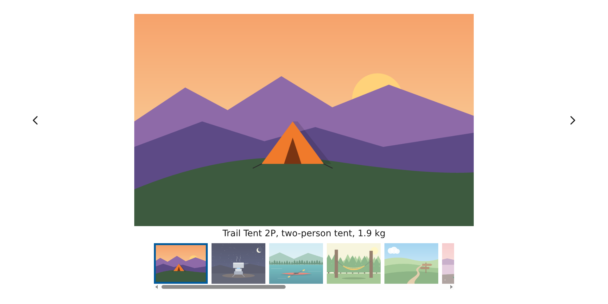
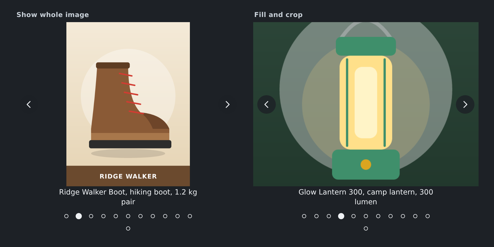
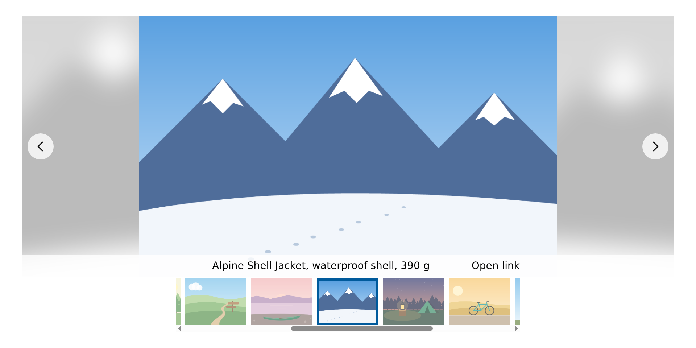
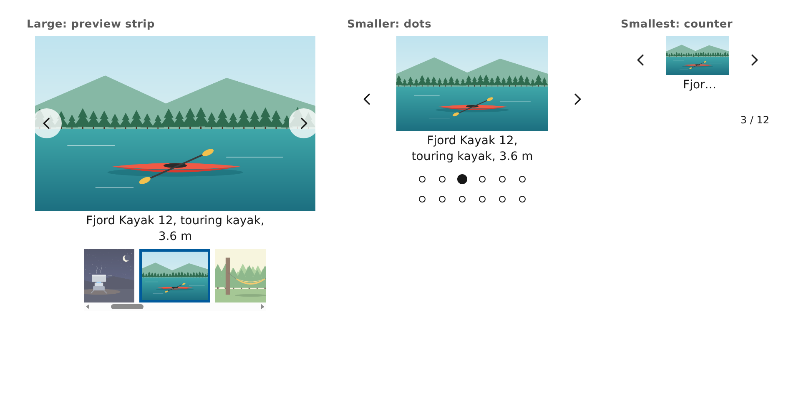
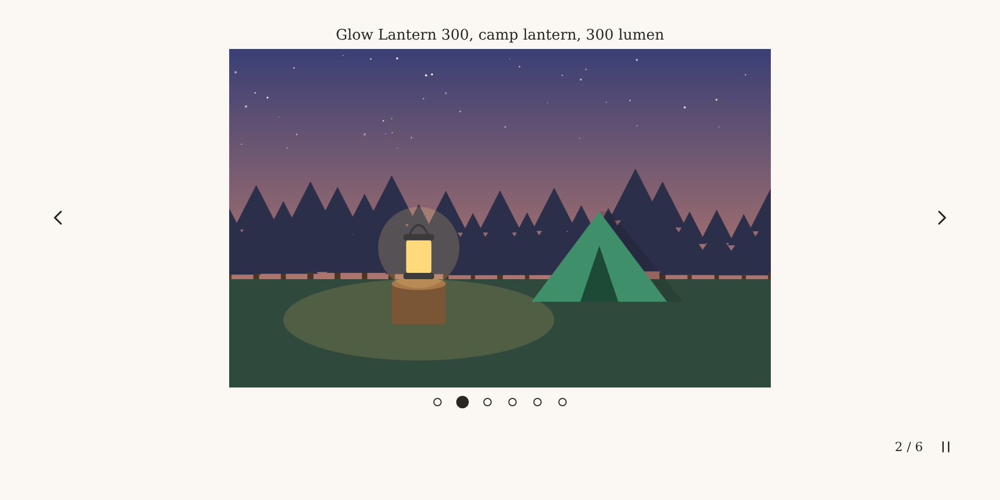
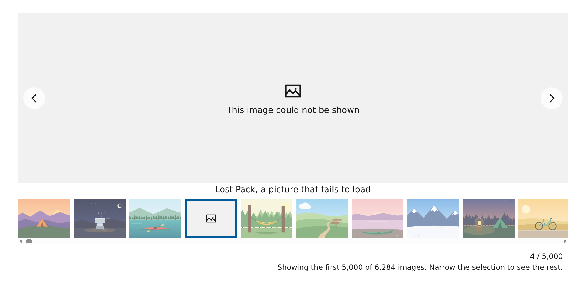

# Tm Image Carousel

Tm Image Carousel is a chart extension for Qlik Cloud that shows pictures from your app
data. Each row becomes one picture, with its own caption, alt text and link, and you can
show one to four pictures side by side. Viewers move through them with arrows, dots, a
preview strip, the keyboard or a swipe, and the carousel follows the selections in the
app. Pictures can come from the app's media library or from `https://` web addresses, and
a click can select the item, open its link or go to another sheet. Add one measure to show a value, such as a price, under each caption. Switch the layout to Gallery to show all the pictures in a grid that scrolls inside the chart, and pick by picture.

Pictures from the app's media library need no setup. Pictures from web addresses need the picture host allowed in your tenant's Content Security Policy (`img-src`); a tenant admin adds it in the Management Console.

## Pictures

All pictures, names and captions are invented demo data.

## Install

1. Download `tallmaker-as-tm-image-carousel-tmimagecarousel.zip` from the
   [Releases](../../releases) page.
2. In the Qlik Cloud Management Console, open **Extensions** and upload the zip.
3. Open an app, edit a sheet and add **Tm Image Carousel** from Custom objects.

The zip holds no licence. The licence comes from the separate Tallmaker licence
extension, which Tallmaker issues to your tenant. Each release also has a demo app
(`tm-image-carousel-demo.qvf`) with its SHA-256 in the release notes.

## Get a licence

See the product page:
[qlikextensions.tallmaker.no/s/tmimagecarousel](https://qlikextensions.tallmaker.no/s/tmimagecarousel).

## Tested

Tested on Qlik Cloud. Client-managed Qlik Sense is untested.

English only.
